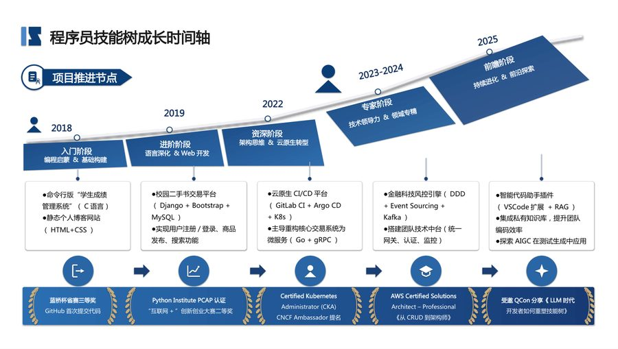
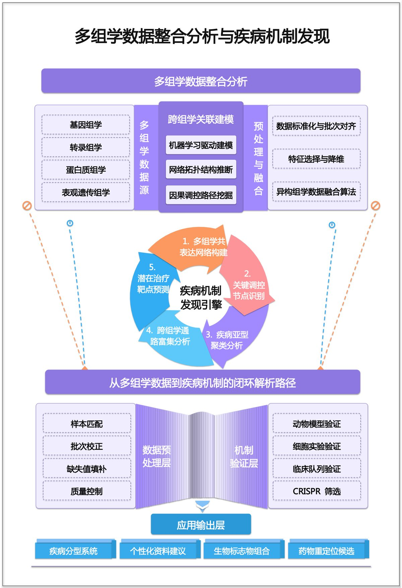
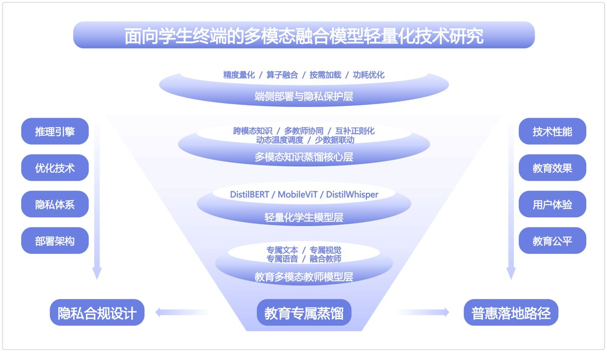
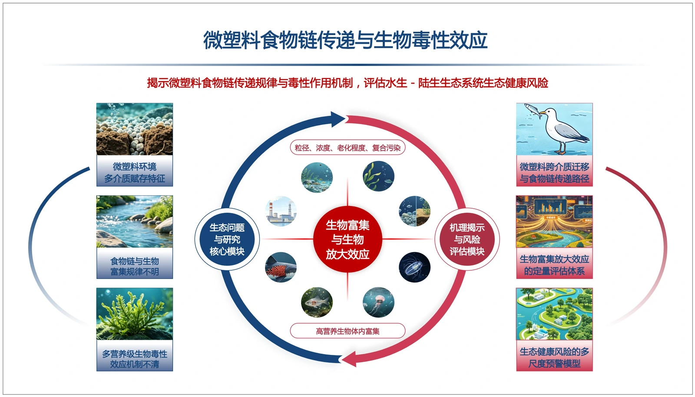
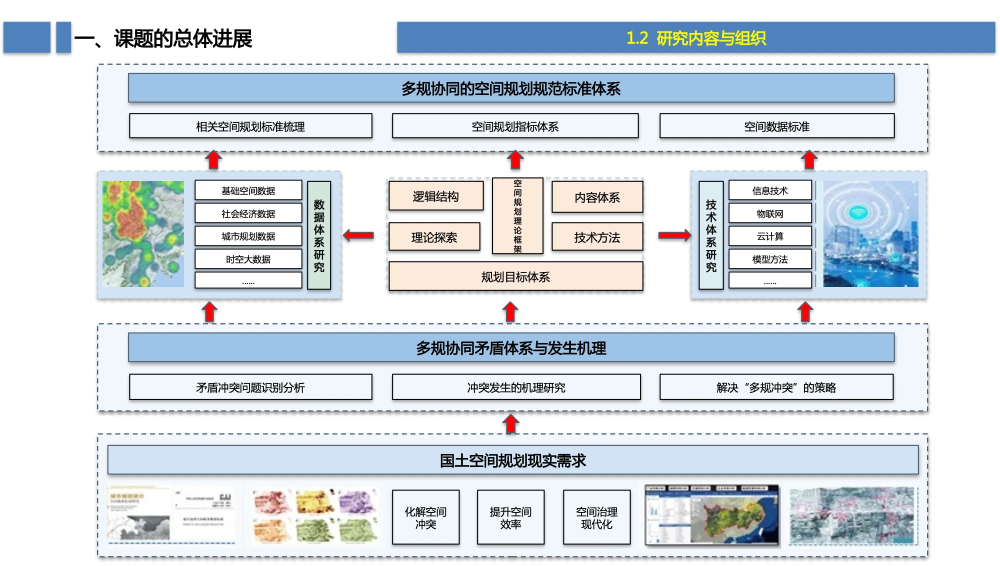
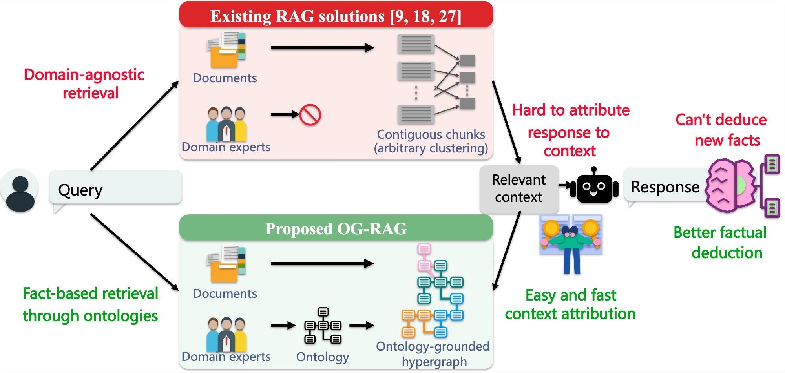

# image2ppt

### 一条 API，把任何图片变成**完全可编辑**的 PPTX。

<p>
  
  
  
  
  <a href="https://github.com/showerberich/image2ppt/actions/workflows/ci.yml"></a>
  <a href="https://github.com/showerberich/image2ppt/stargazers"></a>
</p>

<a href="https://image2ppt.asia"></a>

<p align="center">
  <sub>以上 9 张均选自 <b>60+ 张真实科研图测试集</b> · 每一张都能由 API 重建成可编辑的 PPTX</sub>
</p>

本仓库是 **[image2ppt.asia](https://image2ppt.asia)** 的官方 API 客户端：一个零依赖 Python 库 + 命令行工具。
不在本地跑模型、不装 LibreOffice、不需要 GPU —— **上传图片 → 轮询进度 → 下载原生 PPTX**。

<p align="center">
  <b>在线版</b>：<a href="https://image2ppt.asia">image2ppt.asia</a> ·
  上传图片或 PDF，20–40 分钟后下载可编辑 PPTX ·
  首登赠送 3 积分
</p>

---

## ✨ 为什么不是「截图贴进 PPT」

| | 截图贴图 | image2ppt |
|---|---|---|
| 改一个字 | ❌ 重做整页 | ✅ 双击就能改 |
| 调颜色 / 字号 | ❌ 回 PS 重导出 | ✅ 选中元素直接调 |
| 挪动卡片 / 箭头 | ❌ 只能整张挪 | ✅ 原生形状，随便拖 |
| 团队协作 | ❌ 没人能改 | ✅ 每个人都能编辑 |
| 文件结构 | 一张大位图 | 带语义命名的形状与分组 |

服务端把原图读成元素清单（文字、形状、箭头、图标、配色、坐标），再用 `python-pptx`
重建成**原生文本框和原生形状**，渲染回 PNG 与原图逐块比对、迭代修正，最后交付 PPTX。
**成品里没有整页位图**，每个字、每根箭头都能单独选中。

---

## 🎁 素材示例：网络图片 → 可编辑 PPTX

[`examples/`](./examples/) 里放了一组**转换示例**：设计稿图片来自网络公开模板，
交给 image2ppt 自动转换成**完全可编辑**的 PPTX。每页三件套：
`原图.jpg`（转换输入）+ `成品.pptx`（原生文本框与形状）+ `成品预览.jpg`（渲染图）。

<p align="center">


</p>

| | |
|---|---|
| **示例** | 15 个目录 / 25 页：项目汇报 8 个、科研学术 7 个 |
| **每页文件** | `原图.jpg` + `成品.pptx` + `成品预览.jpg` |
| **完整素材** | [image2ppt.asia 素材页](https://image2ppt.asia/#mat)：222 页，按分类浏览、单页下载 |
| **许可** | 原图版权归原作者；成品可自由修改，请勿原样转售（[说明](./examples/LICENSE.md)） |

**[👉 打开示例目录](./examples/)** · 这里只放少量示例，**不提供整包 / 压缩包下载**；
想看全部素材请到网站素材页逐页挑选。

---

## 🧪 典型科研图 Demo

下面三张都是真实的科研配图，成品由服务端生成，**无需登录即可下载检查可编辑性**：

| | 中文学术框架图 | 环境科研机制图 | 技术架构对比图 |
|:---:|:---:|:---:|:---:|
| **原图** |  |  |  |
| **重建后** |  |  |  |
| **成品 PPTX** | [下载](https://image2ppt.asia/api/examples/academic-framework/pptx) | [下载](https://image2ppt.asia/api/examples/environmental-mechanism/pptx) | [下载](https://image2ppt.asia/api/examples/rag-architecture/pptx) |

- **中文学术框架图**：整页虚线框、色带、密排小字；重建后 32 个文本框、86 个形状，文字全部可改。
- **环境科研机制图**：环状机制、箭头与模块标签全部重建为原生形状，生态照片按区域裁切回贴。
- **技术架构对比图**：跨图连线、箭头、图标重绘为形状，改字改色都不用回原图。

---

## ⚡ 60 秒跑通

### 1. 安装（零运行时依赖）

```bash
pip install "git+https://github.com/showerberich/image2ppt.git"
```

也可以克隆后安装：

```bash
git clone https://github.com/showerberich/image2ppt.git
cd image2ppt && pip install -e .
```

### 2. 换一枚 API 令牌

```bash
image2ppt token --email you@example.com --save
```

密码在终端里输入、不回显；令牌写入 `~/.config/image2ppt/token`（权限 `600`）。

不想装 CLI 也可以直接在网页上拿：登录 [image2ppt.asia](https://image2ppt.asia) →
右上角头像 → **个人中心 → API 令牌** → 输入当前登录密码 → 创建。
令牌明文只显示一次，可一键复制；列表里随时能吊销。

也可以手动设置环境变量：

```bash
export IMAGEPPT_TOKEN=ppt_xxxxxxxx
```

> 令牌只在服务端存 `sha256`，原文只显示一次；随时可以 `image2ppt revoke --yes` 吊销。
>
> 🎁 **首次成功调用 `/api/v1` 任意接口，账号自动到账 5 积分**（每个账号一次，
> 与注册赠送的 3 积分叠加）。`GET /api/v1/me` 里的 `api_bonus_granted` 可以确认是否已领取。

### 3. 转一张图

```bash
image2ppt convert figure.png
# → figure_可编辑.pptx（与原图同目录）
```

转换是异步的，命令会一直等到成品出来，并把服务端的中文进度原样打印：

```text
作业 #12345 已提交（本次扣 1 积分，余额 7 · 含首次 API 赠送的 5 分）
  [0 秒] 排队中
  [3 分 12 秒] 已出第 2 版中间稿，正在对照原图调整…
  [18 分 40 秒] 正在与设计稿逐块比对（最差块：右下角）
成品已保存：/Users/me/figure_可编辑.pptx（18 分 51 秒 · 第 13 版）
```

常用参数：

```bash
image2ppt convert figure.png -o result.pptx      # 指定输出
image2ppt convert figure.png --ratio 16:9        # 跟随原图 / 16:9 / 4:3
image2ppt convert paper.pdf --pages 5            # 多页 PDF 只转前 5 页
image2ppt convert figure.png --no-wait           # 提交后立刻返回
image2ppt status 12345                           # 查进度
image2ppt download 12345 -o result.pptx          # 完成后单独下载
```

---

## 🐍 Python 里调用

```python
from image2ppt import Client

with Client() as client:                     # 读 IMAGEPPT_TOKEN 或令牌文件
    result = client.convert_and_wait(
        "figure.png",
        output="figure_editable.pptx",
        ratio="auto",
        on_progress=lambda job, seconds: print(
            f"{seconds:6.0f}s  {job.stage or job.status}"
            + (f"  第 {job.preview} 版" if job.preview else "")
        ),
    )

print(result.path)          # PosixPath('figure_editable.pptx')
print(result.job.round)     # 最终是第几版
print(result.elapsed)       # 总耗时（秒）
```

失败时抛出的是**能指导下一步动作**的异常，而不是一个裸 `HTTPError`：

```python
from image2ppt import InsufficientCredits, JobFailed, ConversionTimeout

try:
    client.convert_and_wait("figure.png")
except InsufficientCredits as exc:
    print("去这里充值：", exc.recharge_url)   # 402 响应自带充值地址
except JobFailed as exc:
    print("转换失败（积分已退回）：", exc.job.error)
except ConversionTimeout as exc:
    # 作业还在服务端跑：不要重新提交（会再扣一次分）
    print(f"还在跑，稍后用 status {exc.job_id} 查看")
```

只提交、不等待：

```python
submitted = client.convert("figure.png")
print(submitted.job_id, submitted.credits)

job = client.job(submitted.job_id)           # 查一次
job = client.wait(submitted.job_id, timeout=3600)
client.download(job.id, "result.pptx")

client.preview(job.id, "preview.png")        # 最新中间稿渲染图
client.download_round(job.id, job.round)     # 中间稿 PPT
```

完整可运行脚本见 [`examples/convert_example.py`](examples/convert_example.py)。

---

## 🌐 HTTP API

所有 `/api/v1` 接口都要带：

```http
Authorization: Bearer ppt_xxxxxxxx
```

API 地址默认 `https://image2ppt.asia`，自建/测试环境可以用 `IMAGEPPT_BASE_URL` 或 CLI 的 `--base` 覆盖。

| 方法 | 路径 | 说明 |
|---|---|---|
| `GET` | `/api/v1/me` | 邮箱 + 剩余积分 + `recharge_url` |
| `GET` | `/api/v1/pricing` | 计价与限制（动手前先看，别自己编价格） |
| `POST` | `/api/v1/convert` | multipart：`file`、`ratio`（auto/16:9/4:3）、`confirm_pages` |
| `GET` | `/api/v1/jobs/{id}` | `status`（pending/ok/failed）· `stage` · `preview` · `round` · `has_file` |
| `GET` | `/api/v1/jobs/{id}/pptx` | 成品 PPTX（没跑完返回 404） |
| `GET` | `/api/v1/jobs/{id}/preview` | 最新中间稿的渲染图 |
| `GET` | `/api/v1/jobs/{id}/round/{n}/pptx` | 第 n 版中间稿的 PPT |
| `POST` | `/api/auth/token` | 邮箱 + 密码换令牌（第三方工具唯一的入场方式） |
| `POST` | `/api/auth/token/revoke` | 带自己的 Bearer 即可吊销当前令牌 |

### curl 全流程

```bash
# ① 换令牌（只显示这一次）
curl -s -X POST https://image2ppt.asia/api/auth/token \
  -H 'Content-Type: application/json' \
  -d '{"email":"you@example.com","password":"……","name":"my-tool"}'
# → {"ok":true,"token":"ppt_xxx","credits":3,...}

export IMAGEPPT_TOKEN=ppt_xxx

# ② 上传
curl -s -X POST https://image2ppt.asia/api/v1/convert \
  -H "Authorization: Bearer $IMAGEPPT_TOKEN" \
  -F file=@figure.png -F ratio=auto
# → {"ok":true,"job_id":"123","credits":7,"pages":1,"total_pages":1}
#   首次调用会自动 +5（注册 3 + API 首调 5 - 本次 1）

# ③ 轮询
curl -s -H "Authorization: Bearer $IMAGEPPT_TOKEN" \
  https://image2ppt.asia/api/v1/jobs/123

# ④ 下载成品
curl -s -H "Authorization: Bearer $IMAGEPPT_TOKEN" \
  https://image2ppt.asia/api/v1/jobs/123/pptx -o result.pptx
```

### 作业状态

```json
{
  "ok": true,
  "job": {
    "id": 123,
    "status": "ok",
    "stage": "完成",
    "preview": 13,
    "round": 12,
    "rounds": 13,
    "has_file": true,
    "pages": 1,
    "total_pages": 1,
    "error": null
  }
}
```

`status == "ok"` 且有 `has_file` 时成品可下载；`failed` 时 `error` 给出原因，积分自动退回。

---

## 💳 计价与限制

| 项 | 值 |
|---|---|
| 图片 | **1 积分 / 张** |
| PDF | **1 积分 / 页**（超过页数会先返回 `need_confirm`） |
| 新用户 | 首登赠送 **3 积分** |
| API 新用户 | 首次成功调用 `/api/v1` 再送 **5 积分**（每账号一次） |
| 单文件上限 | **40 MB** |
| PDF 页数上限 | **200 页** |
| 支持格式 | PNG / JPG / JPEG / WEBP / BMP / GIF / PDF |
| 典型耗时 | **20–40 分钟**（大图更久） |
| 失败 | **自动退回积分**，不扣费 |

充值在 [image2ppt.asia](https://image2ppt.asia)（微信 / 支付宝）。积分不够时接口返回 **402**，
响应里自带 `recharge_url`：

```json
{
  "detail": "积分不足，请先充值",
  "recharge_url": "https://image2ppt.asia/",
  "hint": "把用户带回上面的地址充值，充完直接重试，不用换令牌"
}
```

---

## ⏳ 为什么要等 20–40 分钟

这不是「一次生成」。服务端做的是一个**自校对循环**：

```text
读图（网格定位 + 小字放大）
  → 输出元素清单
  → 渲染成原生 PPTX
  → 再渲染回 PNG
  → 与原图逐块比对
  → 找最差的一块继续修
  → ……重复十几版
```

慢是因为在逐块核对，不是在排队卡住。所以：

- **不要**用几十秒的超时去轮询，也不要因为「半天没动静」就重新提交 —— 重试会**再扣一次分**；
- 想先看效果：用 `/preview` 拿最新中间稿，或 `/round/{n}/pptx` 拿某一版中间稿 PPT；
- 超时后作业仍在服务端继续跑，用 `image2ppt status <job_id>` 查看即可。

---

## 🧯 退出码与排错

| 退出码 | 含义 | 该做什么 |
|---|---|---|
| `0` | 成功 | — |
| `2` | 令牌无效 / 缺失 | 重新签发令牌，检查 `IMAGEPPT_TOKEN` |
| `3` | 积分不够 | 打开 `recharge_url` 充值，充完直接重试 |
| `4` | 转换失败 | 积分已退回；看服务端给的原因，换更清晰的图 |
| `5` | 等待超时 | 作业还在跑；用 `status` 查，**不要重新提交** |
| `6` | 用法 / 网络 / 其他 | 看错误信息 |

---

## ❓ FAQ

**Q：成品会不会偷偷贴了整页图？**
A：不会。服务端交付的是原生文本框和原生形状；`verify_pptx.py` 那一层也会拦截整页位图。
写实照片 / 插画是唯一允许的局部裁切回贴（`photo`），且不会覆盖整页。

**Q：需要什么模型 / GPU？**
A：本地什么都不需要。所有读图、重建、比对都在 image2ppt.asia 的服务端完成。

**Q：令牌安全吗？**
A：服务端只存 `sha256`，不保存原文；令牌可随时吊销，并记录最近使用时间与来源 IP。
登录/换令牌/验证码都有滑动窗口限流，密码暴力尝试会被 429 拦下。不要把令牌写进代码、
日志或提交到仓库 —— 用环境变量或 `~/.config/image2ppt/token`（权限 600）。

**Q：可以离线用吗？**
A：这个仓库是**在线服务的客户端**，需要网络。离线渲染/校验不在这套 API 的范围内。

**Q：多页 PDF 会一次扣光积分吗？**
A：不会。第一次调用会返回 `need_confirm`，把总页数、将扣积分、默认转几页讲清楚，
确认后才真正扣分。CLI 会交互式询问，非交互环境请显式给 `--pages N`。

---

## 📁 仓库结构

```text
image2ppt/
├── image2ppt/
│   ├── client.py        # 零依赖 HTTP 客户端 + 异常 + 数据结构
│   └── cli.py           # image2ppt 命令行
├── tests/
│   └── test_client.py   # 本地起真实 HTTP 服务，测上传/轮询/下载/错误
├── examples/
│   └── convert_example.py   # 库调用的最小可运行示例
├── assets/              # README 九宫格与科研图对照
├── pyproject.toml
└── .github/workflows/ci.yml
```

运行测试：

```bash
python -m unittest discover -s tests -v
```

---

## 📄 License

[MIT](LICENSE) © [showerberich](https://github.com/showerberich)

<p align="center">
  不想写代码？直接用在线版：<a href="https://image2ppt.asia"><b>image2ppt.asia</b></a>
</p>
