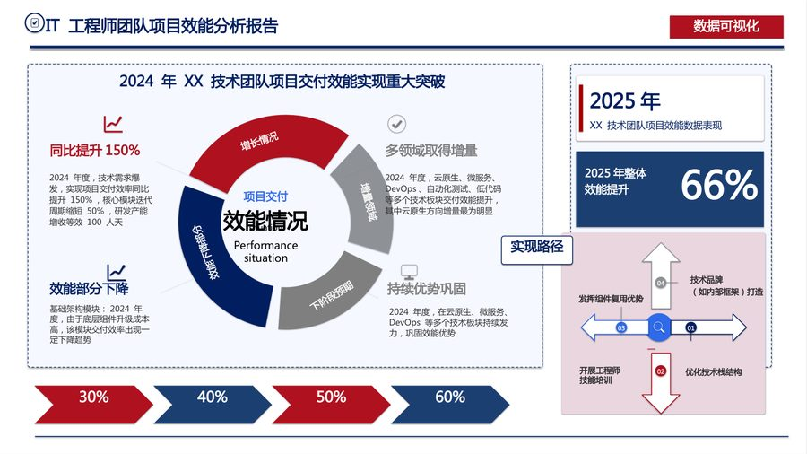
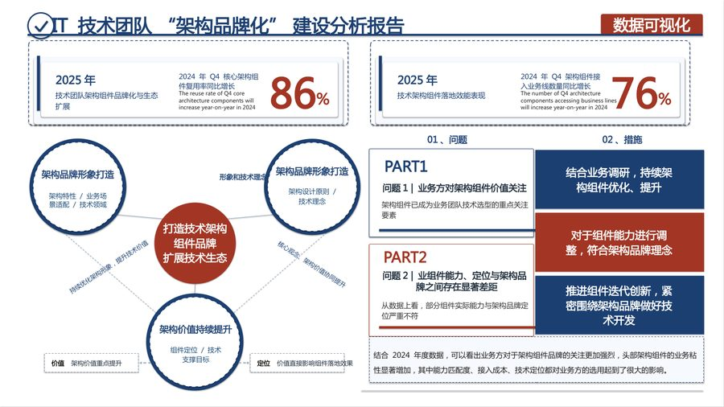
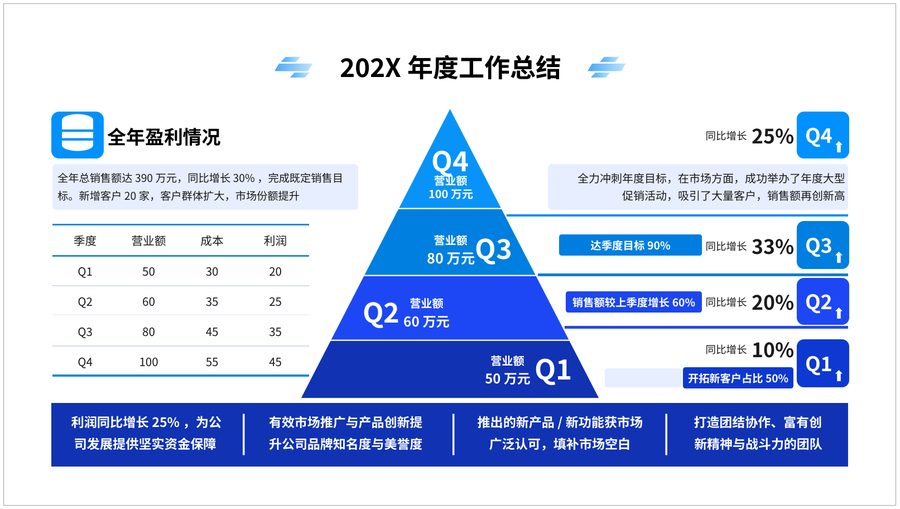
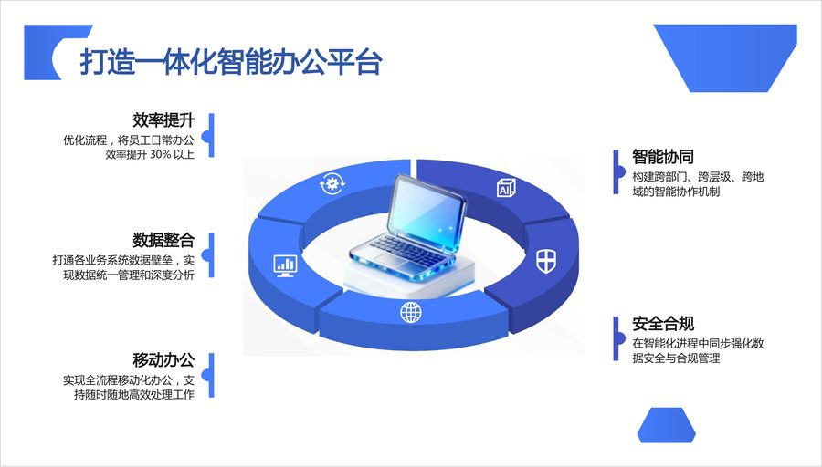
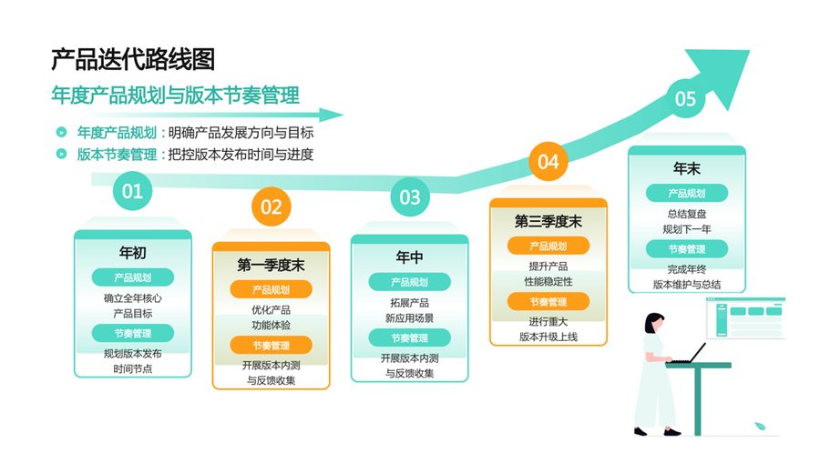
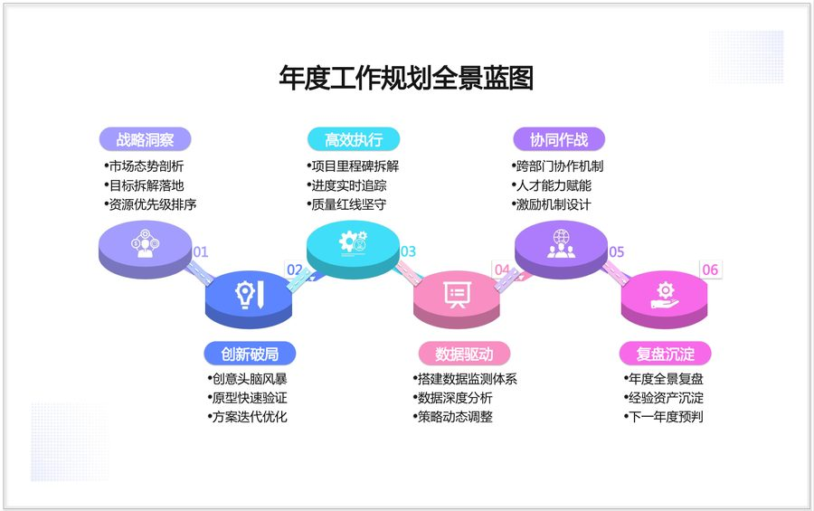
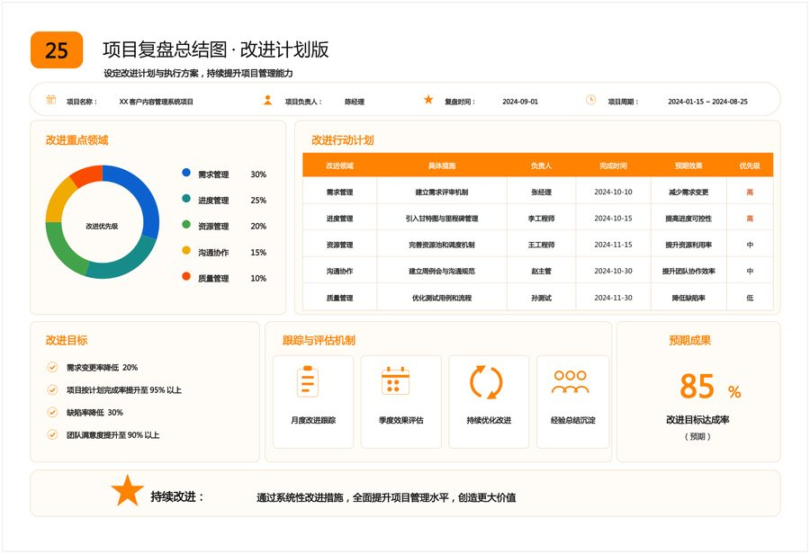

# 项目汇报 PPT 素材包（开源版）

**39 套** 项目汇报 / 年终总结 / 路线图风格设计稿，共 **162 页**。
每一页都配一份**完全可编辑的 PPTX**：文字是原生文本框、色块箭头是原生形状，
打开就能改字、改色、挪位置，不是整页截图。

> 全部成品由 **[image2ppt.asia](https://image2ppt.asia)** 的图片→可编辑 PPTX 管线生成。
> 上传一张图，20–40 分钟后拿回可编辑的 PPTX；本仓库就是这套能力的公开样例。

## 📦 目录

每个模板一个文件夹，套装页按 `第NN页_原图.jpg` / `第NN页_成品.pptx` 成对放：

| # | 模板 | 页数 | 类型 |
|---|---|---|---|
| 01 | [程序员技能树成长时间轴——年度技能进阶与职业发展路线图](./01_程序员技能树成长时间轴——年度技能进阶与职业发展路线图/) | 1 | 单页 |
| 02 | [电商公司年度业务时间轴](./02_电商公司年度业务时间轴/) | 1 | 单页 |
| 03 | [年终总结数据可视化PPT模板](./03_年终总结数据可视化PPT模板/) | 11 | 套装 |
| 04 | [经营态势问题分析与解决方案PPT_-_年终总结与战略调整汇报](./04_经营态势问题分析与解决方案PPT_-_年终总结与战略调整汇报/) | 1 | 单页 |
| 05 | [17页职场工作汇报逻辑图表PPT](./05_17页职场工作汇报逻辑图表PPT/) | 17 | 套装 |
| 06 | [高效的项目启动会模板（ppt）](./06_高效的项目启动会模板（ppt）/) | 17 | 套装 |
| 07 | [202X年度工作总结PPT工作汇报](./07_202X年度工作总结PPT工作汇报/) | 1 | 单页 |
| 08 | [智能制造年中总结汇报PPT模板](./08_智能制造年中总结汇报PPT模板/) | 10 | 套装 |
| 09 | [年度项目进度规划时间轴](./09_年度项目进度规划时间轴/) | 1 | 单页 |
| 10 | [2026新年工作规划路线图模板-年度目标拆解与执行行动计划图](./10_2026新年工作规划路线图模板-年度目标拆解与执行行动计划图/) | 1 | 单页 |
| 11 | [IT工程师优势与劣势分析PPT_-_年终绩效评估与职业发展规划](./11_IT工程师优势与劣势分析PPT_-_年终绩效评估与职业发展规划/) | 1 | 单页 |
| 12 | [科研项目任务拆解思维导图模板-课题分工与成果管理框架](./12_科研项目任务拆解思维导图模板-课题分工与成果管理框架/) | 1 | 单页 |
| 13 | [项目管理汇报PPT模板](./13_项目管理汇报PPT模板/) | 10 | 套装 |
| 14 | [智慧零售数字化转型项目计划PPT模板](./14_智慧零售数字化转型项目计划PPT模板/) | 10 | 套装 |
| 15 | [新年工作计划清单模板-年度目标分解与季度执行规划表](./15_新年工作计划清单模板-年度目标分解与季度执行规划表/) | 1 | 单页 |
| 16 | [年度工作规划四象限模板-重要紧急矩阵时间管理分析图](./16_年度工作规划四象限模板-重要紧急矩阵时间管理分析图/) | 1 | 单页 |
| 17 | [项目章程PPT模板](./17_项目章程PPT模板/) | 10 | 套装 |
| 18 | [产品迭代路线图-年度产品规划与版本节奏管理图](./18_产品迭代路线图-年度产品规划与版本节奏管理图/) | 1 | 单页 |
| 19 | [项目路线图PPT模板](./19_项目路线图PPT模板/) | 1 | 单页 |
| 20 | [项目状态报告PPT模板](./20_项目状态报告PPT模板/) | 10 | 套装 |
| 21 | [OKR规划思维导图-新年团队目标与关键结果制定图](./21_OKR规划思维导图-新年团队目标与关键结果制定图/) | 1 | 单页 |
| 22 | [流程图PPT模板](./22_流程图PPT模板/) | 1 | 单页 |
| 23 | [竞品分析矩阵模板](./23_竞品分析矩阵模板/) | 1 | 单页 |
| 24 | [设备维护计划表-企业设备保养管理与巡检排期表](./24_设备维护计划表-企业设备保养管理与巡检排期表/) | 1 | 单页 |
| 25 | [新年生产效率提升精益生产规划图-精益管理与成本优化布局图](./25_新年生产效率提升精益生产规划图-精益管理与成本优化布局图/) | 1 | 单页 |
| 26 | [高效系统推进工作计划模板-目标分解与执行评估流程图](./26_高效系统推进工作计划模板-目标分解与执行评估流程图/) | 1 | 单页 |
| 27 | [年度营销工作计划思维导图-品牌策略与增长规划图](./27_年度营销工作计划思维导图-品牌策略与增长规划图/) | 1 | 单页 |
| 28 | [营销工作规划清单模板-三栏任务管理与优先级分类图](./28_营销工作规划清单模板-三栏任务管理与优先级分类图/) | 1 | 单页 |
| 29 | [年度工作规划全景蓝图模板-战略拆解与执行落地流程图](./29_年度工作规划全景蓝图模板-战略拆解与执行落地流程图/) | 1 | 单页 |
| 30 | [项目管理流程PPT模板](./30_项目管理流程PPT模板/) | 1 | 单页 |
| 31 | [年度目标拆解流程图模板-战略落地与执行监控蓝图](./31_年度目标拆解流程图模板-战略落地与执行监控蓝图/) | 1 | 单页 |
| 32 | [项目管理计划模板](./32_项目管理计划模板/) | 10 | 套装 |
| 33 | [项目启动演示文稿PPT](./33_项目启动演示文稿PPT/) | 10 | 套装 |
| 34 | [商务汇报PPT模板](./34_商务汇报PPT模板/) | 10 | 套装 |
| 35 | [年中复盘Q3执行路线图模板_20_半年度经营总览仪表盘01](./35_年中复盘Q3执行路线图模板_20_半年度经营总览仪表盘01/) | 1 | 单页 |
| 36 | [研究项目演示示例](./36_研究项目演示示例/) | 10 | 套装 |
| 37 | [项目进度管理可视化模板25_项目复盘总结图_改进计划版](./37_项目进度管理可视化模板25_项目复盘总结图_改进计划版/) | 1 | 单页 |
| 38 | [SWOT分析图模板](./38_SWOT分析图模板/) | 1 | 单页 |
| 39 | [研发项目GRAI复盘](./39_研发项目GRAI复盘/) | 1 | 单页 |

## 🧭 怎么用

1. 打开任意 `成品.pptx`，双击文字即可修改；色块、箭头、图标都是原生形状。
2. `原图.jpg` 是设计稿，用来对照；也可以拿去 [image2ppt.asia](https://image2ppt.asia) 自己再转一次。
3. 想批量拿到这种结果：看 [API 文档](https://github.com/showerberich/image2ppt)，
   或用网页版直接上传。

## ⚖️ 版权与使用范围

设计稿来自 EdrawMax 公开模板库（[album 2039](https://www.edrawmax.cn/templates/album/2039)），
版权归 EdrawMax 及原作者所有。本仓库仅用于展示「图片 → 可编辑 PPTX」的转换效果，
供学习、评测和二次创作参考，**请勿将设计稿原样商用或转售**。
成品 PPTX 中的文字与图形由 image2ppt 重建，可自由修改。
